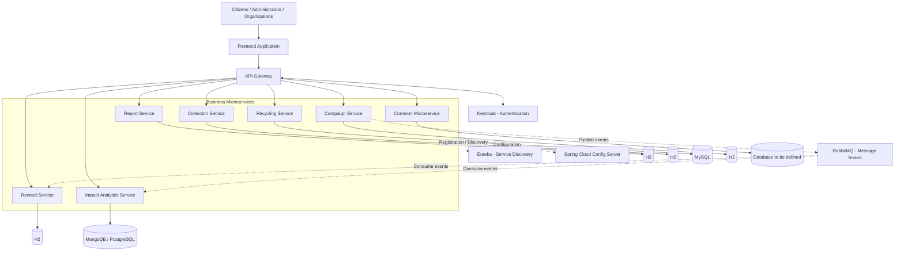

# 🌱 EcoCollect – Smart Environmental Waste Management Platform

## 1. Project Overview

**EcoCollect** is a smart environmental platform designed to improve waste management, encourage recycling, and promote citizen participation in environmental protection.

The platform connects citizens, administrators, waste collection agents, recycling organizations, and environmental campaign organizers through a centralized application based on a **Microservices Architecture**.

It provides a set of independent services that allow users to report environmental problems, request waste collection, locate recycling centers, participate in environmental campaigns, earn rewards, and monitor environmental impact.

## 2. Problem Statement

Waste management and environmental protection face several challenges:

- Illegal waste dumping and environmental pollution.
- Overflowing garbage bins and inefficient waste collection.
- Difficulties coordinating waste collection operations.
- Limited access to recycling information and centers.
- Insufficient citizen participation in environmental initiatives.
- Lack of centralized environmental statistics and impact monitoring.

Traditional approaches often rely on disconnected systems, making coordination and monitoring difficult.

EcoCollect addresses these challenges by bringing the main environmental services together in one digital platform.

## 3. Project Objectives

The main objectives of EcoCollect are to:

- Facilitate the reporting of environmental problems.
- Improve waste collection coordination and management.
- Encourage recycling through accessible information about recycling centers and materials.
- Promote environmental campaigns and citizen participation.
- Motivate citizens through eco-points, badges, and rewards.
- Monitor environmental activities and measure their impact.
- Provide a modular, scalable, and maintainable software architecture.

## 4. Main Actors

| Actor | Description |
|---|---|
| Citizen | Reports environmental problems, requests collection, joins campaigns, and earns rewards. |
| Administrator | Manages platform operations and supervises environmental activities. |
| Collection Agent | Handles waste collection assignments and updates their status. |
| Recycling Organization | Manages recycling centers and accepted materials. |
| Campaign Organizer | Creates environmental campaigns and monitors participation. |

## 5. Main Functionalities

EcoCollect provides the following functionalities:

1. **Environmental Reporting:** Citizens can report illegal dumping, overflowing bins, pollution, and other environmental incidents.
2. **Waste Collection Management:** Users can submit collection requests, while administrators coordinate schedules and assign collection agents.
3. **Recycling Management:** Users can discover recycling centers and available recycling materials.
4. **Environmental Campaigns:** Organizations can create campaigns, define activities and objectives, and allow citizens to participate.
5. **Rewards and Gamification:** Citizens can earn eco-points, receive badges, and participate in environmental leaderboards.
6. **Environmental Impact Analytics:** The platform collects and analyzes environmental data to monitor activities and estimate environmental impact.

## 6. Microservices Architecture

EcoCollect follows a microservices architecture. Each business microservice has its own responsibilities, business logic, API, and database.

### 6.1 Microservices Breakdown

| Microservice | Main Responsibilities | Database |
|---|---|---|
| Report Service | Manages environmental reports, incident descriptions, locations, and report statuses. | H2 |
| Collection Service | Manages waste collection requests, schedules, agent assignments, and collection statuses. | H2 |
| Recycling Service | Manages recycling centers, accepted materials, and recycling information. | MySQL |
| Campaign Service | Manages environmental campaigns, citizen participation, campaign activities, and objectives. | H2 |
| Reward Service | Manages eco-points, rewards, badges, transactions, and leaderboards. | H2 |
| Impact Analytics Service | Collects and analyzes environmental data, statistics, and impact indicators. | MongoDB / PostgreSQL (to be confirmed) |
| Common Microservice | Shared business functionality developed and maintained by the team. | To be defined |

### 6.2 Team Responsibilities

| Student | Assigned Microservice |
|---|---|
| Seif Meddeb  | Report Service |
| Nour Mourali | Collection Service |
| Fatma Mdaghi | Recycling Service |
| Hiba Dkhil   | Campaign Service |
| Islem Medfai | Reward Service |
| Rayen Hbili  | Impact Analytics Service |
| Whole Team   | Common Microservice and shared architecture |

Each student is responsible for designing and developing their assigned microservice, including its entities, class diagram, database, REST APIs, and interactions with other services.

The common microservice and shared infrastructure are coordinated by the entire team.

## 7. Database Management

EcoCollect follows the **Database per Service** principle.

Each microservice owns and manages its own database. A microservice must not directly access or modify another microservice's database.

The proposed database distribution is:

- Report Service → H2
- Collection Service → H2
- Recycling Service → MySQL
- Campaign Service → H2
- Reward Service → H2
- Impact Analytics Service → MongoDB or PostgreSQL (pending confirmation)

This approach ensures service independence and reduces coupling between business components.

## 8. Communication Between Microservices

The platform uses two main communication approaches.

### 8.1 Synchronous Communication – REST APIs

Synchronous communication is used when a service needs an immediate response from another service.

Example:

**Frontend → API Gateway → Campaign Service → Campaign Database → Response**

The caller waits until the requested operation has been processed and a response is returned.

### 8.2 Asynchronous Communication – Message Broker

Asynchronous communication allows services to exchange events without requiring the publisher to wait for each consumer to finish processing.

RabbitMQ is the proposed message broker, subject to final team confirmation.

Example:

When a citizen completes an environmental campaign:

1. Campaign Service publishes a `CampaignParticipationCompleted` event.
2. Reward Service consumes the event and processes the reward calculation.
3. Impact Analytics Service consumes the event and updates environmental statistics.

Each service processes the event independently and maintains its own data.

**Important:** Services communicate through APIs or events, not through direct access to each other's databases.

## 9. Global Architecture

The proposed architecture contains the following components:

- **Frontend:** User interface through which citizens and administrators access the platform.
- **API Gateway:** Central entry point that routes incoming requests to the appropriate microservice.
- **Keycloak:** Authentication and authorization management.
- **Eureka Discovery Server:** Service registration and discovery.
- **Spring Cloud Config Server:** Centralized configuration management.
- **Business Microservices:** The six main services and the common microservice.
- **Independent Databases:** Each service manages its own database.
- **RabbitMQ:** Proposed asynchronous communication infrastructure.
- **Docker:** Containerization and deployment support.

### Architecture Diagram



*Note: This is the proposed logical architecture. Final service routes, database choices, event contracts, and common-service responsibilities will be updated after team validation.*

## 10. Technologies Used

| Technology | Purpose |
|---|---|
| Java | Main backend programming language |
| Swagger / OpenAPI | REST API documentation |
| Spring Boot | Development of independent backend microservices |
| Spring Cloud Gateway | API routing and gateway management |
| Netflix Eureka | Service discovery |
| Spring Cloud Config | Centralized configuration |
| Keycloak | Authentication and authorization |
| H2 Database | Lightweight relational database for selected services |
| MySQL | Relational database for Recycling Service |
| MongoDB / PostgreSQL | Proposed database for Impact Analytics |
| RabbitMQ | Proposed asynchronous messaging |
| Docker | Application containerization |
| Docker Compose | Running and coordinating application containers |
| Git and GitHub | Source code management and collaboration |

Frontend technologies: **[To be completed by the team]**

## 11. GitHub Repository Organization

The project repository is organized as follows:

```text
EcoCollect/
│
├── Backend/
│   ├── report-service/
│   ├── collection-service/
│   ├── recycling-service/
│   ├── campaign-service/
│   ├── reward-service/
│   ├── impact-analytics-service/
│   ├── common-service/
│   │
│   ├── api-gateway/
│   ├── discovery-server/
│   └── config-server/
│
├── Frontend/
│
├── Documentation/
│   ├── Technical-Document/
│   ├── Diagrams/
│   └── Presentation/
│
├── docker-compose.yml
├── README.md
└── .gitignore
```

Each student contributes to their assigned microservice. Shared infrastructure and documentation are maintained collaboratively.

## 12. Installation and Execution

### Prerequisites

Before running the project, install:

- Java JDK 17 or the version selected by the team.
- Maven.
- Git.
- Docker and Docker Compose.
- Node.js and npm, if required by the frontend.
- An IDE such as IntelliJ IDEA.

### Clone the Repository

```bash
git clone <GITHUB_REPOSITORY_URL>
cd EcoCollect
```

### Run Using Docker Compose

After the team has configured the Docker Compose file:

```bash
docker compose up --build
```

To stop the containers:

```bash
docker compose down
```

### Run an Individual Spring Boot Microservice

Navigate to the desired microservice directory:

```bash
cd Backend/campaign-service
```

Run it using Maven:

```bash
mvn spring-boot:run
```

Repeat the process for other services when their configurations are ready.

**Note:** Exact ports, environment variables, database configuration, Keycloak settings, and service startup order will be documented once the integration configuration is finalized.

### API Documentation

Swagger/OpenAPI documentation will be available for each configured microservice.

Example:

```text
http://localhost:<SERVICE_PORT>/swagger-ui.html
```

Replace `<SERVICE_PORT>` with the actual port assigned to the service.

## 13. Development Methodology

The project is developed collaboratively through the following stages:

1. Requirements analysis and project planning.
2. Microservices identification and responsibility distribution.
3. Database and class diagram design.
4. REST API contract definition.
5. Individual microservice implementation.
6. Shared infrastructure development.
7. Microservices integration and communication.
8. Testing and debugging.
9. Documentation and final presentation.

## 14. Project Status

**Current phase:** Microservices design and architecture validation.

The team is defining service responsibilities, entities, database choices, API contracts, communication mechanisms, and the overall architecture before proceeding with full business implementation.

Further implementation and integration will follow the validation of the proposed design.

---

**EcoCollect – Together for a Cleaner and Smarter Environment.** 🌍
